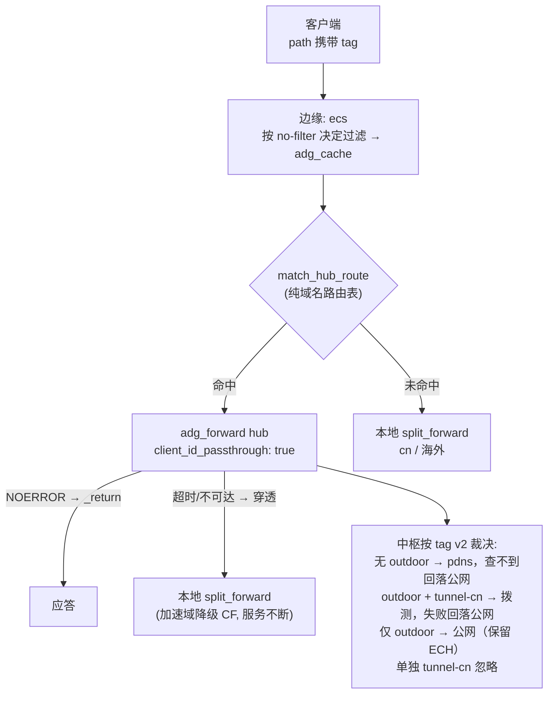

# 情境：中枢-边缘多节点架构

> 多节点部署时的整体形态：中枢为唯一数据源，其余节点为哑路由边缘。
> tag v2 语义见 [README](./README.md)。

## 角色划分

| 角色 | 节点 | 职责 | 持有的数据 |
|------|------|------|-----------|
| 中枢 HUB | 中枢节点 | 按客户端 tag 裁决加速（pdns / 隧道拨测 / 公网回落），本地分流 | pdns + tunnel-hosts.txt（**全网唯一 IP 数据源**） |
| 边缘 EDGE | 各边缘节点 | 按 no-filter 决定广告过滤 / 缓存 / 按路由表把候选域转发中枢 | hub-route-domains.txt（**只有域名，无 IP**） |

设计原则：**易漂移的 IP 数据不出中枢，边缘零加速状态**。新增边缘节点 =
部署边缘配置 + 同步一份纯域名清单，不装 pdns、不复制隧道映射、不做拨测。

## tag 如何跨节点传播：client_id path 透传

客户端连边缘的 URL path 已经是 tag 集合（`/dns-query/outdoor/tunnel-cn` →
`clientIDs = ["outdoor", "tunnel-cn"]`，段数不限、顺序无关，见
[`doh-path.md`](../doh-path.md)）。边缘的 `adg_forward` 开启
`client_id_passthrough` 后，把这套 tag **动态拼到出站 URL path**，中枢按同样
语义裁决：

```
客户端 → 边缘: /dns-query/outdoor/tunnel-cn
边缘   → 中枢: https://hub.example.com:4215/dns-query/outdoor/tunnel-cn   ← tag 原样过境
中枢:   无 outdoor → pdns；outdoor + tunnel-cn → 隧道；仅 outdoor → 公网
```

选型记录：节点间身份通道最终为**双通道并存**——

- **path 通道**：`adg_forward` 的 `client_id_passthrough`，动态拼接出站 URL，
  DoH/DoQ 链路可用，日志直观
- **EDNS 通道**：`edns_client_id` 插件（私有 option 65002，TLV 列表格式），
  随报文走任意传输（UDP/TCP/DoT 皆可），写入/读取/剥离三模式见
  [`edns_client_id`](../plugins/edns_client_id.md)

两通道携带同一 tag 集合时中枢并集去重，幂等无冲突；双载提供传输无关的冗余。
曾经只走单通道的取舍：EDNS 需要两端编解码+出口剥离（读端 read 模式已内建），
path 则一端开关即可——因此 DoH 链路以 path 为主，EDNS 兜住未来 UDP/DoT 中继。

## 流程



## 边缘配置要点（完整样例见部署配置）

```yaml
data_providers:
  - tag: hub_route                       # 纯域名路由表（中枢生成并分发）
    file: /etc/mosdns/hub-route-domains.txt
    auto_reload: true

plugins:
  - tag: match_hub_route
    type: query_matcher
    args:
      domain: ["provider:hub_route"]

  - tag: hub                             # 中枢上游：tag 动态透传
    type: adg_forward
    args:
      client_id_passthrough: true
      upstream:
        - addr: "https://hub.example.com:4215/dns-query"
      bootstrap: ["https://192.0.2.53/dns-query"] # 占位，部署时替换
      timeout: 10
```

```yaml
# default_sequence（cache 之后）
- if: match_hub_route
  exec:
    - hub
    - if: "[_response_noerror]"   # 中枢应答（含空抑制/回落结果）→ 结束
      exec: [_return]             # 超时/不可达 → 穿透本地 split 降级
```

本地降级的应答不带中枢的 TTL 压制：若中枢只是某一条查询超时（如 TYPE65），
边缘会把公网 HTTPS（含 ECH，常见 TTL 300）和中枢给出的隧道/内网 A 记录同时
交给客户端。给路由域的本地降级结果也压 TTL，把这个毛刺限制在短窗口内：

```yaml
plugins:
  - tag: cap_route_ttl
    type: ttl
    args:
      maximum_ttl: 30             # 与中枢 tunnel_accelerate 的 ttl 一致

# default_sequence（本地 split_forward 之后）
- split_forward
- if: match_hub_route
  exec: [cap_route_ttl]
```

边缘**不需要**：`tunnel_accelerate`、`ech_block`、`forward_pdns`、
`_response_noerror` 之外的中枢插件——加速逻辑全部集中在中枢。

## tag 组合的下发（以 no-filter 为例）

1. 各节点用 `client_id: [no-filter]` 定义匹配器，广告过滤加否定条件
2. 按需分发 `/dns-query/outdoor/no-filter` 或
   `/dns-query/outdoor/tunnel-cn/no-filter`，只跳过广告过滤，不改变解析路线
3. **边缘转发零改动**——tag 经透传自动到达中枢，组合无需枚举上游

## 路由表生成（中枢定时更新任务）

```sh
cat internal_accelerate-domains.txt > hub-route-domains.txt
awk '{print $1}' tunnel-hosts.txt | grep -v '^#' >> hub-route-domains.txt
sort -u hub-route-domains.txt -o hub-route-domains.txt
# 分发到各边缘 /etc/mosdns/hub-route-domains.txt
```

## 边界行为

| 情境 | 行为 |
|------|------|
| 中枢不可达 | 边缘穿透本地 split_forward，加速域降级 CF，服务不断 |
| 路由表条目在中枢已失效 | 中枢走自己兜底返回公网结果，边缘无感知 |
| 新增隧道/内网域名 | 只更新中枢数据 + 重生成路由表，边缘 auto_reload 生效 |
| 客户端多 tag 组合 | 集合语义；隧道须同时含 outdoor + tunnel-cn，no-filter 独立控制过滤 |
